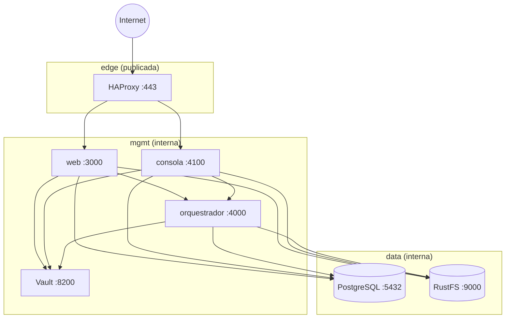

# labmastery-deploy

**Repositorio único de despliegue de LabMastery** (decisión D23). Contiene el `compose` de todo el
sistema y la configuración de los componentes de terceros (HAProxy, Vault, PostgreSQL, S3).

El criterio es el de **Harbor Registry**: muchos componentes, pero un solo repositorio y un solo
`compose` que los levanta todos.

> **Los repos de servicio NO tienen compose.** El código y la topología son cosas separadas: aquí se
> despliega, allí se desarrolla.

## Disposición

```
labmastery-deploy/
├── compose.yaml              # compose principal (produccion)
├── compose.override.yaml     # solo desarrollo (monta los repos en vez de imágenes)
├── .env.example              # plantilla (el .env real lo genera el playbook)
├── ansible/
│   ├── site.yml              # playbook de despliegue
│   ├── inventory/hosts.ini
│   ├── templates/env.j2      # plantilla del .env
│   └── vault/secrets.yml     # secretos del despliegue (cifrados con ansible-vault)
├── haproxy/
│   ├── haproxy.cfg           # configuración ESTÁTICA (frontends, TLS, backends base)
│   └── certs/                # certificados TLS (NO se commitean)
├── vault/
│   ├── policies/             # una política por servicio (mínimo privilegio)
│   └── init.sh               # inicialización (root token, mounts)
├── postgres/
│   └── init/01-init.sh       # asigna contraseñas a los roles y aplica el DDL
└── scripts/
    ├── deploy.sh             # wrapper de ansible-playbook
    └── smoke.sh              # verificación post-despliegue
```

## Los tres planos de secrets

Este es el punto central del diseño (D23 §5):

| Plano | Qué guarda | Dónde vive | Qui lo usa |
|---|---|---|---|
| **1 — Despliegue** | Variables de **arranque** (capa 1 de D22) | `ansible-vault` → `.env` del host | Los procesos, como variables de entorno |
| **2 — Runtime** | Valores de los **ajustes secrets** (capa 2 de D22) | Contenedor **Vault** (KV v2) | Los procesos, resolviendo la referencia de `settings` |
| **3 — Ajustos** | Valores **no secretos** y **referencias** | PostgreSQL | Los procesos, y la consola para administrarlos |

**No hay circularidad:** Vault (runtime) necesita su credencial para arrancar → sale de ansible-vault.
Y ansible-vault necesita su clave para desxifrar → vive en el gestor de secrets del CI, no en Vault.

**El `.env` generado no se commitea** (`.gitignore`), vive solo en el host con permisos `0600`.

## Topología



**Solo HAProxy toca Internet.** PostgreSQL, Vault y S3 no se publican en producción.

## Despliegue

```bash
# 1. Configurar el vault de ansible (una sola vez)
ansible-vault encrypt ansible/vault/secrets.yml
echo -n "tu contrasena" > ~/.labmastery-vault-pass && chmod 600 ~/.labmastery-vault-pass

# 2. Desplegar
./scripts/deploy.sh

# 3. Verificar
./scripts/smoke.sh
```

El playbook: descifra el vault → inicializa Vault (root token, políticas, mount KV v2) → genera el
`.env` → levanta el compose → verifica.

> **El vault de este repo está cifrado con la contraseña de ejemplo
> `labmastery-dev-vault-password`.** Es un fichero **plantilla**: los valores son `CAMBIA-ESTO`.
> Antes de usarlo en serio, re-cifra con tu propia contraseña:
>
> ```bash
> ansible-vault decrypt ansible/vault/secrets.yml   # descifra
> # edita los valores
> ansible-vault encrypt ansible/vault/secrets.yml   # cifra con TU contraseña
> ```

## Desarrollo

```bash
docker compose --profile dev up -d
```

El perfil `dev` monta los repos en vez de usar imágenes, deja PostgreSQL con datos efímeros y arranca
Vault en modo `dev` (token raíz `prova`).

Requiere los repos de servicio **al lado** de este:

```
labmastery/
├── labmastery-deploy/     ← este
├── labmastery-packages/
├── labmastery-db/
├── labmastery-orchestrator/
├── labmastery-web/
└── labmastery-console/
```

## HAProxy: qué es estático y qué es dinámico

- **Estático** (`haproxy/haproxy.cfg`): frontends, listeners, TLS, backends base. Cambia por commit.
- **Dinámico** (en runtime): las rutas de los labs, que añade el orquestador vía la **Data Plane API**
  (`haproxy.dataplane.*` en `orch.settings`).

La Data Plane API no puede definir frontends, listeners ni TLS: por eso el reparto es estructural.

## Vault: mínimo privilegio

| Política | Permisos |
|---|---|
| `labmastery-web` | `read` en `secret/data/labmastery/web/*` |
| `labmastery-console` | `read`/`create`/`update` + `list` en `labmastery/console/*` |
| `labmastery-orchestrator` | `read`/`create`/`update` + `list` en `labmastery/orch/*` |

La consola es la **única que escribe**: es la que guarda el secreto en el almacén y la referencia en la BD.

## Verificación

`scripts/smoke.sh` comprueba lo que exige §9 del diseño: servicios sanos, DDL aplicado, Vault
respondiendo y sin sellar, políticas con el mínimo privilegio, los tres servicios con credencial,
HAProxy enrutando y copias de seguridad.

## Fases

| Fase | Qué |
|---|---|
| P1 | Repo y compose (hecho) |
| P2 | Imágenes del web y la consola (`Dockerfile` multi-stage; resolver los paquetes `file:`) |
| P3 | Vault en modo `server`: inicialización, políticas |
| P4 | ansible-vault: el playbook que genera los `.env` |
| P5 | HAProxy: TLS y conexión con la Data Plane API del orquestador |
| P6 | Copias de seguridad: pgBackRest a S3, copia de Vault |

## Documentación

El diseño completo está en
[labmastery-docs/08-despliegue.md](https://github.com/gabrielgbs97/labmastery-docs/blob/main/08-despliegue.md)
(D23) y en
[07-configuracio.md §6](https://github.com/gabrielgbs97/labmastery-docs/blob/main/07-configuracio.md)
(D22, los magatzems de secrets).

## Licencia

MIT.
